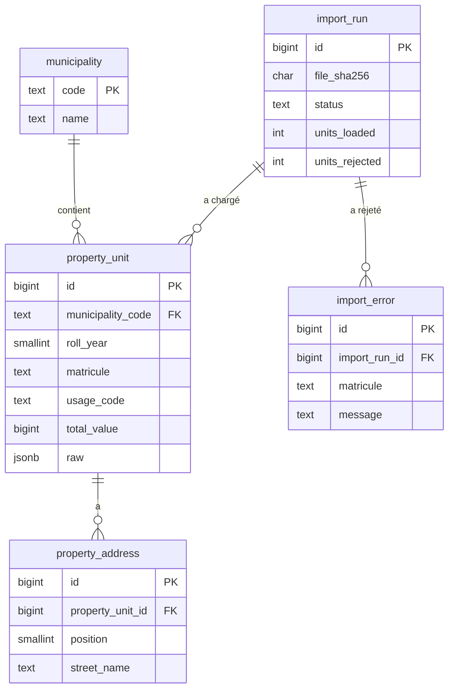

# Analyse et choix de conception

## 1. Les données

### Source
Le jeu de données « Rôles d'évaluation foncière du Québec » (Données Québec, licence CC-BY 4.0) publie, chaque année,
**un fichier XML par municipalité** (plus de 1 100 dans l'index 2026), ainsi qu'une archive ZIP de tous les fichiers.
Un fichier d'index CSV (`indexRole2026.csv` : code géographique, nom, lien) donne l'adresse de chaque fichier.

Documentation officielle utilisée :
- *Répertoire des renseignements prescrits du rôle d'évaluation foncière*, version 2.5 (2022) : liste des champs,
  obligatoires ou non, types, tailles et domaines de valeurs.
- *Guide sur les données du rôle en format ouvert*.

### Structure d'un fichier

```xml
<RL>
  <VERSION>2.9</VERSION>          <!-- version du format -->
  <RLM01A>01042</RLM01A>          <!-- code géographique de la municipalité -->
  <RLM02A>2025</RLM02A>           <!-- année d'entrée en vigueur du rôle -->
  <RLUEx>                         <!-- une unité d'évaluation (répété) -->
    <RL0101> <RL0101x>…</RL0101x> </RL0101>   <!-- adresse(s), groupe répétable -->
    <RL0104> <RL0104A>0174</RL0104A> … </RL0104>   <!-- matricule -->
    <RL0105A>1000</RL0105A>       <!-- code d'utilisation (CUBF) -->
    <RL0402A>5700</RL0402A>       <!-- valeur du terrain -->
    <RL0404A>5700</RL0404A>       <!-- valeur de l'immeuble -->
    …
  </RLUEx>
</RL>
```

Les champs sont regroupés en 5 sections : (1) identification de l'unité, (2) propriétaire, (3) caractéristiques,
(4) valeurs, (5) répartition fiscale. Certains groupes sont **multiples** dans une même unité (adresses `RL0101x`,
lots `RL0103x`, historique `RL0201x`, répartitions fiscales `RL0504x`).

### Sous-ensemble analysé

| Municipalité | Code | Taille | Unités | Version | `RLM02A` |
|---|---|---|---|---|---|
| Grosse-Île | 01042 | 0,6 Mo | 593 | 2.9 | 2026 |
| Petite-Vallée | 03015 | 0,4 Mo | 324 | 2.8 | 2025 |
| Rivière-à-Claude | 04020 | 0,4 Mo | 293 | 2.9 | 2025 |
| Sherbrooke | 43027 | 68 Mo | 56 325 | 2.9 | 2025 |

Trois petites municipalités pour itérer vite, et une grande ville pour valider la mémoire et le temps de traitement.
Le profil complet (taux de présence de chaque champ) est dans [profile-2026.txt](profile-2026.txt),
produit par `npm run profile`.

### Problèmes constatés

1. **Volume.** Un fichier peut peser des dizaines de Mo (68 Mo pour Sherbrooke). Charger le fichier entier en mémoire
   (DOM) n'est pas viable à l'échelle de la province : la lecture se fait donc en streaming.
2. **Valeurs codées.** Les balises (`RL0404A`…) et de nombreuses valeurs (`RL0105A` code CUBF, `RL0101Ex` générique
   de rue `CH`, `RL0303A` zonage agricole 0/1/2…) sont des codes qui exigent le répertoire et des nomenclatures externes.
3. **Le nom du fichier ne donne pas l'année du rôle.** `RL04020_2026.xml` contient `RLM02A = 2025` : les rôles sont
   triennaux, le fichier « 2026 » contient le rôle en vigueur, qui peut avoir débuté en 2025.
   → L'année est lue dans le contenu.
4. **Versions hétérogènes.** Le répertoire documente la version 2.5 ; les fichiers sont en 2.8 ou 2.9, la même année.
   Des blocs présents dans les fichiers ne figurent pas dans le répertoire 2.5 (lots du cadastre `RL0103`).
   → Le contenu complet de chaque unité est conservé en JSONB pour ne rien perdre.
5. **Champs manquants, souvent pour une bonne raison.** Exemples de taux de présence :

   | Champ | Grosse-Île | Petite-Vallée | Rivière-à-Claude | Sherbrooke |
   |---|---|---|---|---|
   | N° civique (`RL0101Ax`) | 46 % | 41 % | 44 % | 91 % |
   | Année de construction (`RL0307A`) | 47 % | 46 % | 48 % | 90 % |
   | Valeur du bâtiment (`RL0403A`) | 49 % | 51 % | 56 % | 90 % |
   | Nombre de logements (`RL0311A`) | 38 % | 38 % | 46 % | 86 % |
   | Valeur de l'immeuble (`RL0404A`, obligatoire) | 100 % | 100 % | 100 % | 100 % |

   En milieu rural, environ la moitié des unités sont des terrains sans bâtiment ni numéro civique.
   → Une valeur absente devient `NULL` (jamais `0`), et seule l'absence d'un champ **obligatoire** est une erreur.
6. **Champs propres à certaines villes.** `RL0102A` (arrondissement) n'existe qu'à Sherbrooke ; `RL0106A`
   (n° de dossier) est absent à Sherbrooke et présent à 9 % à Petite-Vallée.
7. **Pas de données personnelles.** Les noms des propriétaires ne sont pas publiés ; seuls la date d'inscription et
   un statut fiscal le sont.

### Contrôles de qualité positifs
- Le **matricule** (`RL0104A` à `F`) est **unique** dans chacun des 4 fichiers : c'est une clé fiable.
- Sur les 47 859 unités ayant une valeur de terrain et de bâtiment, **terrain + bâtiment = immeuble dans 100 % des cas**.
- Chaque unité de ce sous-ensemble a **exactement une adresse**, même si le répertoire en permet plusieurs.

## 2. Modèle de données

SQL complet : [../db/migrations/001_init.sql](../db/migrations/001_init.sql)



| Table | Rôle |
|---|---|
| `municipality` | Une ligne par municipalité (code, nom issu de l'index officiel) |
| `property_unit` | Une ligne par unité d'évaluation et par rôle ; ~20 champs typés + `raw` (JSONB) |
| `property_address` | Adresses d'une unité (groupe répétable `RL0101x`) |
| `import_run` | Journal : une ligne par tentative d'import d'un fichier (statut, empreinte, compteurs, erreur) |
| `import_error` | Une ligne par unité rejetée (position, matricule, champ, message) |

**Pourquoi ce modèle :**
- **Clé naturelle** `UNIQUE (municipality_code, roll_year, matricule)` : elle rend un doublon impossible et permet
  de garder plusieurs rôles (années) côte à côte.
- **Colonnes typées** (`bigint` pour les valeurs, `numeric` pour les superficies, `date`, `boolean`) pour les champs
  utiles à l'analyse : requêtes SQL simples et contrôles de type par la base.
- **JSONB `raw`** pour le reste : aucun champ perdu, robuste aux changements de version, et un champ peut être
  « promu » en colonne plus tard sans réimporter.
- **Table enfant pour les adresses** pour montrer le traitement d'un groupe répétable. Les autres groupes (lots,
  historique, répartitions fiscales) restent dans `raw` pour limiter le périmètre ; ils suivraient le même modèle.
- **Journal en base** (`import_run`, `import_error`) : on peut répondre à « quelle version de quel fichier est
  chargée, quand, et qu'est-ce qui a été rejeté ? » avec une simple requête.

## 3. Processus d'import

1. **Empreinte.** Calcul du SHA-256 du fichier. Si ce contenu est déjà la dernière version importée avec succès
   pour sa municipalité et son année, le fichier est ignoré (`skipped`). Le nom et la date d'un fichier peuvent
   changer sans que le contenu change (et inversement) ; l'empreinte, non.
2. **Journal.** Création d'une ligne `import_run` au statut `running`, en dehors de la transaction, pour qu'elle
   survive à un échec.
3. **Lecture (streaming).** Parseur SAX (`saxes`) : chaque `<RLUEx>` est transformé en objet puis libéré.
   Les groupes répétables deviennent des tableaux.
4. **Validation de l'en-tête.** Code municipal (`RLM01A`) et année (`RLM02A`) obligatoires et valides, sinon le
   fichier entier échoue.
5. **Remplacement du périmètre.** Dans **une seule transaction** : suppression des unités de cette municipalité et
   de cette année, puis insertion du nouveau contenu. Le fichier est considéré comme la vérité complète pour son
   périmètre : un simple *upsert* ne supprimerait pas les unités disparues du rôle.
6. **Validation et nettoyage de chaque unité** (règles du répertoire) : champs obligatoires, entiers, décimaux,
   dates `AAAA-MM-JJ`, domaines (`RL0303A` ∈ {0,1,2}, `RL0307B` ∈ {E,R}…), bornes (`RL0307A` entre 1600 et 2050).
   Conversion des booléens et construction du matricule (`0174-87-0100`).
7. **Chargement par lots** de 1 000 unités (INSERT multi-lignes), puis des adresses.
8. **Seuil de rejet.** Si plus de 5 % des unités sont rejetées, rollback : un taux élevé signale plutôt un
   changement de format qu'une erreur ponctuelle.
9. **Commit** et mise à jour du journal (`success` / `failed`, compteurs, message).

### Gestion des erreurs

| Niveau | Exemple | Effet |
|---|---|---|
| Fichier | XML mal formé, en-tête invalide, matricule en double, > 5 % de rejets | Rollback, `failed`, anciennes données intactes |
| Unité | Valeur non numérique, date invalide, champ obligatoire absent | Unité ignorée, ligne dans `import_error`, import poursuivi |
| Lot de fichiers | Un fichier échoue | Les autres continuent ; code de sortie `1` |

### Tests réalisés

| Test | Résultat |
|---|---|
| Import initial des 4 fichiers | 57 535 unités chargées, 0 rejet |
| Relance sans changement | 4 × `skipped` |
| Relance forcée (`--force`) | Mêmes volumes, 0 doublon sur la clé |
| Fichier tronqué | `failed`, données précédentes conservées |
| Une unité invalide | `success`, 1 rejet tracé avec matricule et champ |
| 10 % d'unités invalides | `failed` (seuil), données conservées |
| Version A → version B → version A | La version A est bien rechargée (bug trouvé et corrigé grâce à ce test) |
| Tests unitaires (`npm test`) | 9/9 : nettoyage, rejets, en-tête, parseur, XML mal formé |

### Performance
Sherbrooke : 56 325 unités en ~7 s, mémoire maximale ~100 Mo, indépendante de la taille du fichier.
Extrapolation (hypothèse : quelques millions d'unités pour la province) : de l'ordre de 10 minutes sur un poste
de développement.

## 4. Hypothèses

- Un fichier contient le rôle **complet** d'une municipalité pour une année : il remplace la version précédente.
- Le matricule (`RL0104A` à `F`) identifie une unité de façon unique dans une municipalité et un rôle (vérifié sur
  le sous-ensemble).
- L'année du rôle est `RLM02A`, pas l'année du nom de fichier.
- Les règles de validation suivent le répertoire 2.5, même si les fichiers sont en version 2.8/2.9.
- Les unités de mesure (front, superficie, aire d'étages) ne sont pas indiquées dans le répertoire : les valeurs
  sont stockées telles quelles.

## 5. Limites et suites possibles

- **Nomenclatures non décodées** (CUBF, génériques de rue, codes fiscaux) : on ajouterait des tables de référence.
- **Groupes répétables partiellement normalisés** : seuls les adresses ; lots, historique et répartitions fiscales
  sont dans `raw`.
- **Pas de géolocalisation** : le jeu de données propose une version géoréférencée (GeoJSON/GPKG) qui pourrait être
  jointe sur le matricule avec PostGIS.
- **Pas de téléchargement automatique** : l'index CSV permet de l'ajouter simplement, par exemple dans un workflow
  n8n (télécharger → `npm run import` → alerte selon le code de sortie).
- **Historique** : le modèle garde un rôle par année, mais ne trace pas les mises à jour en cours de rôle
  (l'index trimestriel `indexRole.csv` le permettrait).
- **Seuil de 5 %** : valeur arbitraire, à ajuster avec l'expérience.

